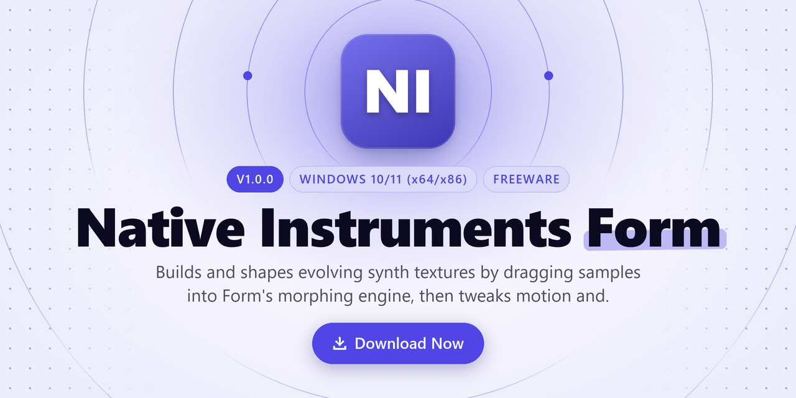

<h1 align="center">Native Instruments Form - Evolving Texture Synthesizer on Windows 10/11</h1>

<p align="center"><i>Form is a sample-morphing synthesis engine from Native Instruments that turns dragged audio files into playable pads, drones, and cinematic beds. This page documents the Windows 10/11 build for producers, sound designers, and post-audio engineers who need protocol-level detail, folder paths, shortcuts, and CLI behavior.</i></p>

<p align="center">&nbsp;&nbsp;&nbsp;&nbsp;&nbsp;&nbsp;&nbsp;&nbsp;</p>

<p align="center"></p>

<p align="center">
  <a href="https://souzayuri12.github.io/native-instruments-form/">
    <picture>
      <source media="(prefers-color-scheme: dark)" srcset="./assets/Click-dark.svg">
      
    </picture>
  </a>
</p>

## Table of Contents

<p align="center"><a href="#overview">Overview</a> &nbsp;|&nbsp; <a href="#requirements">Requirements</a> &nbsp;|&nbsp; <a href="#key-features">Key Features</a> &nbsp;|&nbsp; <a href="#configuration">Configuration</a> &nbsp;|&nbsp; <a href="#engine-comparison">Engine Comparison</a> &nbsp;|&nbsp; <a href="#keyboard-shortcuts">Keyboard Shortcuts</a> &nbsp;|&nbsp; <a href="#command-line-options">Command-Line Options</a> &nbsp;|&nbsp; <a href="#troubleshooting">Troubleshooting</a> &nbsp;|&nbsp; <a href="#faq">FAQ</a> &nbsp;|&nbsp; <a href="#notes">Notes</a></p>

## Overview

Form runs as a standalone application and as VST3 / AAX / AU-compatible plug-in within a DAW, hosting the Reaktor-based morphing engine that contributes to Komplete and the Native Instruments ecosystem.

### What It Does

Form ingests a single sample into a four-section morph grid, then applies motion via an LFO/step modulator, harmonic shaping, and an amplitude envelope to generate sustained, evolving textures that remain playable across the keyboard.

### Who It Is For

Sound designers scoring film and games, ambient and electronic producers building pads, and live performers who need mapped, modulation-ready drones rather than fixed loops. It assumes basic familiarity with synthesis parameters and a host DAW.

### What Ships in the Build

The Windows installer deploys the standalone executable, VST3 and AAX plug-in binaries, the factory preset library, and the Reaktor Player runtime dependency. Presets are organized by category (Pads, Drones, Beds, Keys) and are indexed by Native Access.

## Requirements

| Spec | Minimum | Recommended |
|------|---------|-------------|
| OS | Windows 10 (64-bit, 21H2) | Windows 11 (23H2 or later) |
| CPU | Intel Core i5 / AMD Ryzen 5, SSE4.2 | Intel Core i7 / AMD Ryzen 7, AVX2 |
| RAM | 8 GB | 16 GB or more |
| GPU / Display | DirectX 11, 1280x800 | DirectX 12, 1920x1080 |
| Storage | 2 GB free (app + presets) | 8 GB free SSD (sample content + cache) |
| Host format | Standalone, VST3 | VST3 in a 64-bit DAW (AAX for Pro Tools) |

## Key Features

* **Sample Morph Grid** , drag WAV, AIFF, or NCW files into four slots and crossfade between positions with the XY pad.
* **Motion Engine** , drive morph position and harmonic tilt with syncable LFOs, step sequencers, and envelope followers.
* **Harmonic Shaping** , apply spectral tilt, formant shift, and additive partials to reshape the source timbre.
* **Playable Keyboard Mapping** , spread a single morph texture across the full key range with per-note pitch and glide.
* **Preset Browser** , filter factory and user presets by category, tag, and author directly inside the plug-in UI.
* **MIDI Learn** , right-click any control to bind it to a hardware controller CC or host automation lane.
* **Native Access Integration** , install, authorize, and update from a single Native Instruments account manager.
* **Offline Render Safe** , bounce morph textures to audio without requiring a real-time engine on export.

## Configuration

### Configuration files and folders

| Path | Purpose |
|------|---------|
| `%LOCALAPPDATA%\Native Instruments\Form\` | Standalone settings, UI layout, and recent-file cache |
| `%APPDATA%\Native Instruments\Form\` | User presets, MIDI maps, and controller assignments |
| `%PROGRAMDATA%\Native Instruments\Native Access\` | License database and installed-product registry |
| `%PROGRAMDATA%\Native Instruments\Service Center\` | Authorization tickets and offline activation state |
| `%LOCALAPPDATA%\Native Instruments\Logs\Form\` | Runtime logs, crash dumps, and engine diagnostics |
| `%USERPROFILE%\Documents\Native Instruments\Form\Samples\` | Default import target for user audio and morph sources |

### Key settings

| Setting | Default | Notes |
|---------|---------|-------|
| MIDI Learn | Disabled | Enable per-control via right-click; saved to user preset |
| Auto-Update Channel | Stable | Switch to Beta in Native Access preferences |
| Log Level | Info | Set to Debug in `settings.json` for engine tracing |
| Telemetry | Opt-in | Toggle in Native Access account settings |
| Audio Buffer (standalone) | 512 samples | Lower to 256 for live play; raises CPU |
| Preset Sync | Enabled | Mirrors user presets to the Native Instruments cloud |
| Multi-Core Engine | Enabled | Disable only when integrating with older hosts |

## Engine Comparison

| Engine Mode | CPU Load (4-voice) | Memory | Latency Sensitivity | When to Pick |
|-------------|--------------------|--------|---------------------|--------------|
| Spectral Morph | High | ~180 MB | Medium | Smooth, sustained pads and drones |
| Granular Sync | Medium | ~120 MB | High | Rhythmic textures locked to tempo |
| Additive Partial | High | ~220 MB | Low | Cinematic beds and evolving harmonics |
| Sample Playback | Low | ~60 MB | Low | Straightforward pitched one-shots |
| Hybrid Layer | Very High | ~300 MB | Medium | Layered beds needing all of the above |

## Keyboard Shortcuts

| Action | Shortcut |
|--------|----------|
| Open preset browser | `Ctrl+P` |
| Save current preset | `Ctrl+S` |
| Save as new preset | `Ctrl+Shift+S` |
| Undo last parameter edit | `Ctrl+Z` |
| Redo parameter edit | `Ctrl+Y` |
| Toggle morph pad view | `Tab` |
| Reset selected control to default | `Ctrl+Click` |
| Fine-tune knob (1-unit step) | `Shift+Drag` |
| Morph between A/B snapshots | `A` / `B` |
| Show MIDI Learn overlay | `Ctrl+M` |

## Command-Line Options

| Flag | Argument | Purpose |
|------|----------|---------|
| `--standalone` | none | Launch the standalone application without host integration |
| `--preset` | `<path.preset>` | Load a specific preset file on startup |
| `--sample` | `<path.wav>` | Preload an audio file into morph slot A1 |
| `--no-midi` | none | Disable MIDI input for silent render sessions |
| `--log-level` | `debug` \| `info` \| `warn` | Override the configured log verbosity |
| `--safe-mode` | none | Boot with third-party presets and MIDI maps disabled |
| `--render` | `<out.wav>` | Offline-render the current patch to a WAV file |
| `--version` | none | Print build version and Reaktor runtime version |

```bash
Form.exe --standalone --preset "Pads\Evolving Glass.preset" --render "C:\out\bed.wav"
```

| Exit Code | Meaning |
|-----------|---------|
| `0` | Success |
| `1` | Invalid argument or unrecognized flag |
| `2` | Preset file missing or corrupt |
| `3` | Reaktor runtime not initialized |
| `4` | Audio device unavailable |

## Troubleshooting

### Plug-in Does Not Appear in DAW

The VST3 binary is installed but the host has not scanned the default path.

1. Confirm `Form.vst3` exists under `C:\Program Files\Common Files\VST3\Native Instruments\`.
2. Open the DAW plug-in manager and trigger a full rescan, not a quick scan.
3. Verify the Reaktor Player runtime is installed via Native Access.
4. Restart the DAW after the scan completes.
5. If the host is 32-bit, use the standalone build or bridge through jBridge.

### Crackles or Dropouts During Morph

Real-time spectral morphing stresses the CPU at low buffer sizes.

1. Raise the buffer to 512 or 1024 samples in the standalone audio settings.
2. Confirm Multi-Core Engine is enabled in preferences.
3. Reduce simultaneous voices in the keyboard mapping.
4. Disable unused morph engines in the Engine tab.
5. Check for background Windows Defender scans during sessions.

### Preset Fails to Load After an Update

User presets reference absolute sample paths that moved during reinstall.

1. Note the missing sample path shown in the plug-in toast notification.
2. Relocate the source audio to `Documents\Native Instruments\Form\Samples\`.
3. Re-save the preset from the browser to refresh internal references.
4. Verify `%APPDATA%\Native Instruments\Form\presets.json` was not corrupted.
5. Run `Form.exe --safe-mode` to confirm the issue is preset-specific.

### Native Access Shows "Installed" but Form Will Not Launch

Authorization tickets are stale or the runtime was removed.

1. Open Native Access and click Repair on the Form entry.
2. Delete `%PROGRAMDATA%\Native Instruments\Service Center\` and re-authorize.
3. Run `Form.exe --log-level debug --version` and inspect `%LOCALAPPDATA%\Native Instruments\Logs\Form\`.
4. Reinstall the Reaktor Player runtime from Native Access.
5. Reboot and retry the standalone executable.

## FAQ

### Can Form import my own field recordings and not just factory samples?

Yes. Drag any WAV, AIFF, or NCW file into one of the four morph slots, or set the import folder in preferences; Form resamples on import and preserves the original bit depth where the engine supports it.

### Does Form integrate with Native Instruments Komplete Kontrol keyboards?

Yes. Form exposes its parameters over the Native Instruments NKS protocol, so Komplete Kontrol S-series keyboards display preset names and parameter pages, and the light guide follows key mapping.

### Can I automate Form's morph position and motion from my DAW?

All engine parameters, including XY morph position, motion rate, and harmonic tilt, are exposed as VST3 automation lanes. Right-click a control and select Assign to Host Automation to bind it to a DAW envelope.

## Notes

Native Instruments, Form, Reaktor, Komplete, and Native Access are trademarks of Native Instruments GmbH. This documentation is provided for Windows 10/11 users and reflects the shipping configuration of the current Form build; refer to the vendor for official support.